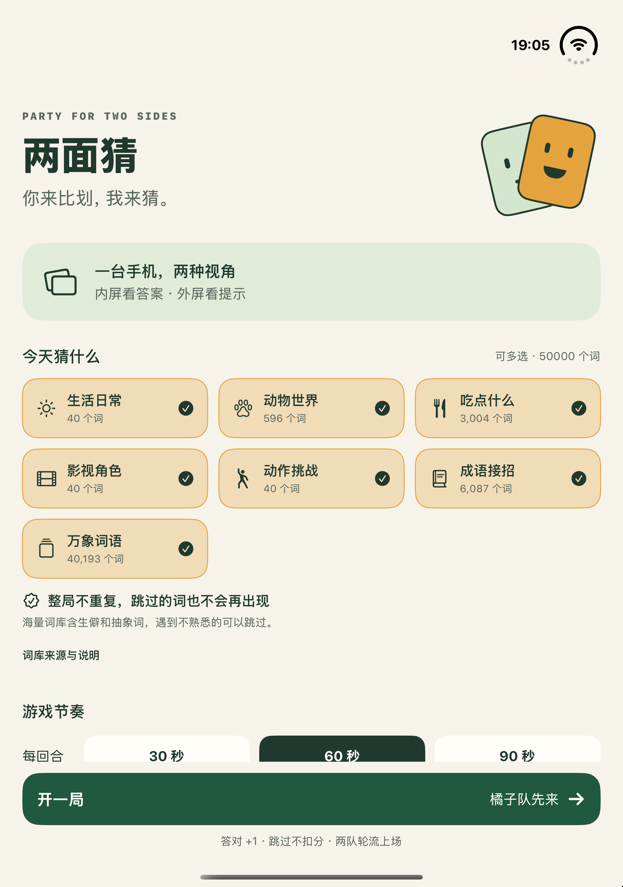
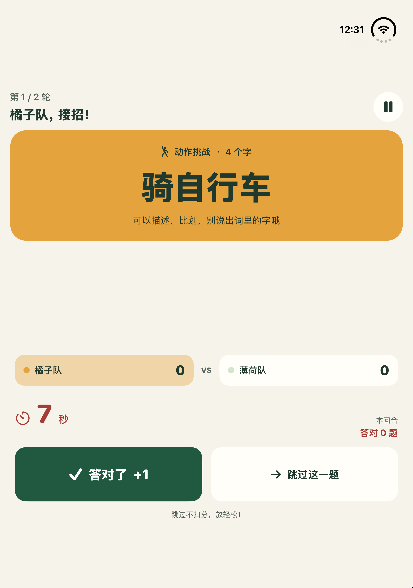
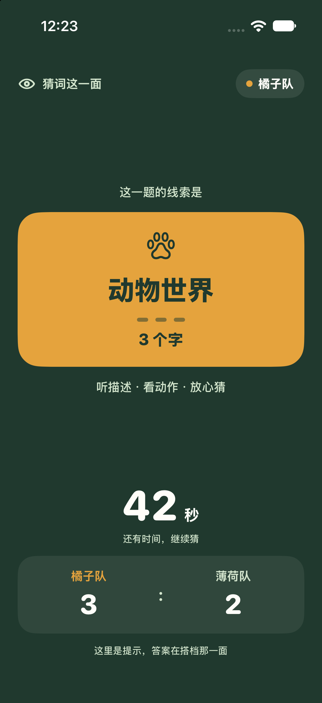

# 两面猜 · TwoSides

**一台手机，面对面你说我猜。** 用 SwiftUI 编写的中文聚会猜词小游戏：iPhone Duo 内屏给描述者看答案，外屏给猜词者看提示；内置 **7 类、50,000 个唯一中文词条**，整局抽词不重复。

普通 iPhone 和模拟器也能玩单屏版，或预览双方画面。项目当前通过 Xcode 从源码构建安装，尚未提供 App Store 版本。

## 画面预览

| 选择词库 | 比划方 · 半折布局 | 猜词方 · 安全提示 |
| --- | --- | --- |
|  |  |  |

前两张来自 Duo 模拟器，第三张是猜词方画面预览，**均不证明真实相机与外屏已经联动**。[更多截图](Screenshots/) 中部分画面来自早期版本，可能仍显示 240 词或旧布局；当前 50,000 词的依据是打包资源、[词库报告](Data/wordbank-report.json)及自动测试，不以旧截图作为数量证明。

## 怎么玩

| 角色／画面 | 能看到什么 | 怎么操作 |
| --- | --- | --- |
| 描述者 · 内屏 | 当前答案、类别、字数、时间、比分 | 用语言或动作提示，点击「答对了」或「跳过这一题」 |
| 猜词者 · 外屏 | 类别、字数、倒计时、比分和公开反馈 | 看搭档比划、听描述，大声猜答案 |
| 普通手机 · 单屏 | 描述者界面 | 由描述者持机，避免让猜词者看到词卡 |
| 双方画面预览 | 示例内屏／外屏画面 | 在大厅点「先看看双方画面」切换视角，不启动相机 |

1. 选择一个或多个词库，设置每回合 **30 / 60 / 90 秒**、每队 **1 / 2 / 3 轮**。
2. Duo 双屏玩法先展开设备，从内屏开启「面对面模式」并允许相机访问。启动成功后，相机小窗会自动收起为底部状态栏；点「预览」可展开，再点「收起」隐藏画面。收起时相机仍运行，外屏继续显示。普通手机可以直接开局。
3. 点击「开一局」，准备 3 秒后开始。描述时不要说出答案里的字；**答对 +1，跳过不扣分**。
4. 橘子队和薄荷队轮流上场，每回合结束可查看答对、跳过及词条记录，最终比较比分。

整局两队共用同一个词堆。答对、跳过和已经展示但未作答的词都会被消耗；暂停后继续的是原题。所选分类用完会提前结束并保留比分，若两队完成的轮次数不同则不宣告胜负。重新开局会重新洗牌，可能遇到以前对局的词。

## 功能

- **双视角隔离**：外屏只接收不含答案的 `AudienceState`，不接收词卡或历史答案。
- **折叠适配**：根据系统提供的折痕保留区域安排左右／上下布局，兼容横竖屏。
- **中断保护**：切到后台、合盖或外屏失效时暂停并隐藏答案；返回后需主动继续。
- **离线词库**：50,000 词随应用打包，按分类缓存计数，支持多选；大厅可查看词库来源与许可。
- **清楚的结算**：单轮记录、双方总分、词库耗尽提示；不循环补词。
- **易读易点**：大按钮、中文无障碍标签、动态字体与减少动态效果支持。
- **轻量实现**：没有第三方运行时依赖，无需后端或 API Key。

## 环境与安装

### 运行要求

| 项目 | 要求 |
| --- | --- |
| 开发工具 | 能运行 **Xcode 27.1** 的 macOS；Swift 6 |
| 单屏游戏／画面预览 | iOS 27.0 或更新版本的设备、模拟器 |
| Duo 内外屏同时展示 | **iPhone Duo + iOS 27.1 或更新版本** |
| 维护脚本 | Python 3；日常直接打开工程运行不需要执行脚本 |

Duo 外屏能力带有 iOS 27.1 可用性检查。**内屏全屏展示应用、应用处于前台、相机会话保持活动**是同时显示外屏的必要条件；模拟器的猜词方预览不能替代这项真机验证。

### 在模拟器运行

1. 下载或克隆本仓库，用 Xcode 27.1 打开 [TwoSides.xcodeproj](TwoSides.xcodeproj)。
2. 选择共享的 **TwoSides** scheme，再选已安装的 iOS 27.0 或 27.1 模拟器。
3. 点击 Run（⌘R），在大厅直接开局，或先预览双方画面。

模拟器没有真实相机；点击「面对面模式」会显示说明，仍可继续玩单屏版。若缺少对应系统运行时，先在 Xcode 中下载。

### 在自己的 iPhone／Duo 安装

1. 在 Xcode 登录自己的 Apple 账户。连接并解锁手机，按设备提示信任电脑，让 Xcode／Device Hub 完成配对。
2. 在手机「设置 → 隐私与安全性 → 开发者模式」开启 **Developer Mode**，按提示重启，并在重启后确认开启。若该选项尚未出现，先完成与 Xcode 的配对。步骤见 [Apple 官方说明](https://developer.apple.com/documentation/xcode/enabling-developer-mode-on-a-device)。
3. 选择 `TwoSides` target，在 **Signing & Capabilities** 勾选自动管理签名，选择自己的 **Team**，将 **Bundle Identifier** 改成自己唯一的标识符。若运行 UI 测试，也为 `TwoSidesUITests` 配置自己的签名和对应标识符。
4. 在 Xcode 选择自己的手机，点击 Run。首次安装时按系统提示完成开发者信任或授权。
5. Duo 先展开到内屏，再开启「面对面模式」并允许相机访问，让搭档看向外屏。

仓库不附带个人签名证书或配置文件。工程生成脚本会重写工程文件；重新生成后请检查本地 Team 与 Bundle Identifier，自定义标识符也可同步到生成脚本中。

## 词库与来源

当前词库由 **240 个基础词 + 49,760 个扩展词**组成。扩展内容来自固定版本的 jieba 与清华 THUOCL，经过字数、汉字、词性／词频、有限排除规则和规范化去重筛选，没有拼接词语凑数量。

| 生活日常 | 动物世界 | 吃点什么 | 影视角色 | 动作挑战 | 成语接招 | 万象词语 |
| ---: | ---: | ---: | ---: | ---: | ---: | ---: |
| 40 | 596 | 3,004 | 40 | 40 | 6,087 | 40,193 |

五万词中仍有生僻、抽象、专业词和分类歧义，尚未逐条人工审核；遇到不熟悉的题可跳过。规范化答案不会在整局重复，但繁简体、别称、近义词不一定代表不同概念，也不保留跨对局／跨重启的已玩词记录。

- [WORD_BANK.md](WORD_BANK.md)：来源版本、筛选规则、质量边界、不重复规则和重建方法。
- [WordSources.txt](Sources/Core/Resources/WordSources.txt)：随应用打包的来源说明与两份完整 MIT 许可。
- [wordbank-provenance.tsv](Data/wordbank-provenance.tsv)：每个新增词对应的上游来源、词频及词性。
- [wordbank-report.json](Data/wordbank-report.json)：分类统计、产物哈希和重建报告。

词库加载器严格检查 UTF-8、格式、分类、2–8 字纯汉字、重复和数量。文件缺失或损坏时，大厅显示具体错误，只保留基础词库，不会显示虚假的五万词数量。

## 代码结构

`GameEngine` 管理倒计时、轮次、比分与整局词堆；SwiftUI 页面观察它的状态。`AudienceView` 只使用经过裁剪的公开状态。`CameraController` 在串行队列上配置预览会话，由根视图协调相机、外屏、折叠与前后台状态。

```text
TwoSides/
├── TwoSides.xcodeproj/          # iOS 应用与 UI 测试、共享 scheme
├── Package.swift               # 可独立测试的 CharadesCore 包
├── Sources/
│   ├── App/                    # 大厅、游戏、猜词方、结算与视觉主题
│   ├── Camera/                 # AVFoundation 预览与会话生命周期
│   └── Core/                   # 游戏状态机、词条模型、严格词库加载器
│       └── Resources/          # 扩展 TSV 和来源／许可文本
├── Resources/                  # Info.plist、原创图标与资源目录
├── Tests/
│   ├── CharadesCoreTests/      # Swift Testing：核心规则与词库
│   └── UITests/                # XCTest：完整流程与隐私保护
├── scripts/                    # 工程生成、图标绘制、词库重建
├── Data/                       # 词条来源追踪与统计报告
├── Screenshots/                # 模拟器与画面预览截图
├── DESIGN.md                   # 视觉与交互设计约定
└── WORD_BANK.md                # 词库说明
```

Xcode 应用直接编译 `Sources/App`、`Sources/Core`、`Sources/Camera`。SwiftPM 只编译核心模块，并用 `Bundle.module` 加载资源；应用通过 `Bundle.main` 加载同一份资源。

### 相机与外屏的关闭顺序

相机小窗的展开／收起只改变可见布局，同一个预览对象保持挂载，捕获连接不会被移除或重建。收起后，底部状态栏保留「相机运行中 · 不录制」说明与关闭按钮。

点预览条的 **×** 或大厅的 **关闭**，都会先撤销外屏显示与相机开启请求，并进入「关闭中」状态。相机会话在串行后台队列停止；确认停止后，主线程才移除预览层与旋转观察者。即使合盖或页面消失提前触发 SwiftUI 卸载，控制器也会保留预览对象直到停止完成，避免拆除预览与 `stopRunning()` 同时操作捕获连接。

停止期间不会接受重复开关；旧的授权或启动回调也不会重新打开外屏。AVFoundation 通知先在发布线程接收，再异步转到主线程，避免发布线程等待主线程。

## 开发与测试

以下命令都在项目根目录执行。使用 Xcode 27.1 对应的命令行工具。

```sh
# 重新生成工程：新增／移除 Swift 文件或资源后执行
python3 scripts/generate_project.py

# 核心规则与词库测试，无需启动模拟器
swift test

# 不签名构建模拟器版本
xcodebuild -project TwoSides.xcodeproj -scheme TwoSides \
  -destination 'generic/platform=iOS Simulator' \
  -derivedDataPath build/DerivedData CODE_SIGNING_ALLOWED=NO build

# 查看可用模拟器；下面 UI 测试的设备名与系统版本需与本机一致
xcrun simctl list devices available

# UI 测试
xcodebuild -project TwoSides.xcodeproj -scheme TwoSides \
  -destination 'platform=iOS Simulator,name=iPhone 18 Pro Max,OS=27.0' \
  -derivedDataPath build/DerivedData CODE_SIGNING_ALLOWED=NO test

# 可选：重绘原创几何 AppIcon
swift scripts/create_icon.swift
```

相机关闭回归需要 **展开、解锁并已允许相机权限的 Duo 真机**；模拟器会跳过这项测试。将占位符换成自己的设备 UDID 和开发团队：

```sh
xcodebuild -project TwoSides.xcodeproj -scheme TwoSides \
  -destination 'platform=iOS,id=YOUR_DUO_UDID' \
  -derivedDataPath build/DeviceTests DEVELOPMENT_TEAM=YOUR_TEAM_ID \
  -allowProvisioningUpdates \
  -only-testing:TwoSidesUITests/TwoSidesUITests/testDuoCameraAccessoryClosesAndReopensWithoutFreezing \
  -only-testing:TwoSidesUITests/TwoSidesUITests/testDuoCameraBackgroundStopsAndPauses test
```

第一项要求外屏就绪后自动收起相机小窗，检查手动展开／收起仍保持外屏就绪，再交替验证 **× / 关闭** 共四次。每次关闭后打开双方画面演示检查界面响应，最后继续游戏。第二项开启相机后切换到系统设置，确认应用已进入后台，再验证返回时暂停、相机关闭和恢复游戏。普通 iPhone 的真机测试可用 `-skip-testing:` 排除这两项 Duo 专用用例。

词库已纳入仓库，**正常编译和游戏无需下载词典**。仅在需要重建数据时执行：

```sh
python3 scripts/build_wordbank.py
python3 scripts/generate_project.py
swift test
```

重建脚本首次从固定上游地址下载并校验 SHA-256，之后可用 `python3 scripts/build_wordbank.py --offline` 从本地缓存重建。详细输入、输出与参数见 [词库重建说明](WORD_BANK.md#重建)。

## 隐私与当前局限

- 相机只在主动开启面对面模式后用于实时预览；不拍照、不录制视频、不录音，不申请麦克风或相册权限。
- 应用无需登录，无分析 SDK、广告或游戏数据上传；游戏与词库在本机运行，重建词库的开发脚本另有联网下载行为。
- 外屏不接收答案或历史词卡。相机与外屏开启、两种关闭入口和后台恢复已有 Duo 真机回归；首次授权、系统中断和连续合盖场景仍需更多真机覆盖。
- 当前没有自动语音判分、在线联机、云同步或永久对局记录；由描述者手动判断答对／跳过。
- 源码安装依赖使用者自己的开发签名，不提供 App Store／TestFlight 下载入口。

## 验证状态

最近验证：**2026-10-26 · Xcode 27.1 · Duo 真机 iOS 27.2**。

| 范围 | 结果与边界 |
| --- | --- |
| 核心与词库 | **29 项测试通过**，覆盖计时、暂停、快速重复操作、轮次、整局无重复、词库耗尽与末轮结束原因、50,000 词完整性和严格加载 |
| UI（模拟器） | **5 项测试通过**：完整对局、猜词方不泄露答案、后台返回保护、模拟器相机降级、正式词库加载与来源说明 |
| 普通手机模拟器 | 检查横竖屏、辅助大字体、关键按钮可达与滚动布局 |
| Duo / iOS 27.1 模拟器 | 检查展开、半折、旋转、合盖开局以及游戏中合盖后的暂停与答案隐藏 |
| 构建与数据 | 真机 SDK 和模拟器 SDK 均构建成功；扩展词均可追溯到固定上游原始行，离线重建的四份数据产物逐字节一致 |
| Duo 真机 | 修复版已签名安装；**2 项专项回归通过**：每次等待外屏就绪，交替使用 × / 关闭共四次并重开；另验证相机开启时真正切到后台、返回暂停、相机停止与继续游戏。与核心、模拟器测试合计 **36 项通过** |

真机回归验证的是系统报告外屏就绪及开启／关闭／后台生命周期。仓库中的截图仍是模拟器与画面预览；不同折叠姿态下的实际外屏视觉效果需要单独检查。

**预览自动收起更新：** Duo 真机已通过自动收起、手动展开／收起及四次关闭／重开回归，并从双屏截图确认收起后外屏继续显示提示。上表的后台专项通过记录来自关闭修复版本 `c80fa79`；本次后台复测因截图工具错误中断，重试时设备锁屏，未完成复跑。

## 许可

本仓库暂未提供项目整体的 `LICENSE`。上游 jieba、THUOCL 词库按各自 MIT 许可使用，完整声明见 [WordSources.txt](Sources/Core/Resources/WordSources.txt)；这些数据许可不代表整个应用采用 MIT 许可。
